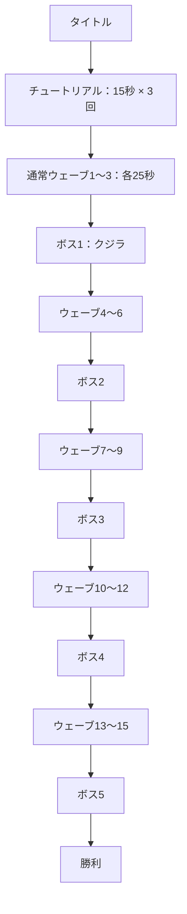

# 現在のゲーム進行

難易度選択のない、日本語専用の一本道の冒険です。

ボス2～5はサメ・イカ・カメ・カジキを毎回シャッフルした順番です。重複しません。各ボスの戦闘は時間制限を設けず、撃破するまで続きます。

## カードと回復

- 現在のカードの種類・効果・重ねがけを維持しています。
- チュートリアルのカードは通常ウェーブ1へ引き継ぎます。
- 各ウェーブ終了後に既存の選択方式でカードを選びます。
- ボス1～4の撃破後もカードを選び、その次の通常ウェーブへ進みます。
- ボス5の撃破後は勝利画面へ進みます。
- ウェーブ終了時の回復、ボス撃破時の最大体力50%回復も維持しています。
- カードが最大まで重なった場合の回復処理も既存のままです。

## 区間ごとの自動成長

経験値・レベル・経験値アイテム・レベルアップ時のランダム成長を廃止しました。敵を倒した数はスコアとカードの撃破時効果にだけ使用します。カードの抽選に運の上昇は加えません。

| 区間 | 通常ウェーブ | 最大体力 | 攻撃 | 移動速度 | ジャンプ待ち時間 | 被ダメージ軽減 |
|---|---|---|---|---|---|---|
| 1 | 1～3 | 基礎値 | 基礎値 | 基礎値 | 基礎値 | 0% |
| 2 | 4～6 | +20% | +15% | +4% | -5% | 4% |
| 3 | 7～9 | +40% | +30% | +8% | -10% | 8% |
| 4 | 10～12 | +60% | +45% | +12% | -15% | 12% |
| 5 | 13～15 | +80% | +60% | +16% | -20% | 16% |

表は基礎値に対する区間の累計補正です。カードの補正を加えた後も、最大体力350、移動速度340、ジャンプ待ち時間の下限0.35秒など、既存の上限・下限を適用します。空中移動も同じ速度補正を受けます。攻撃補正はスラム・衝撃波・弾に適用します。次の区間へ進んでも、同じ区間のボス戦へ入っても、毎回基礎値から計算するため重複しません。

最大体力が増えた時だけ、その増加量を現在体力に加えます。同じ補正を再計算しただけで追加回復することはありません。チュートリアル中は既存の練習用補正のみを使い、画面には「練習」と表示します。

## 敵の出現数

冒険中のウェーブ番号を `n`、`s = n - 1` とします。

- 出現間隔：`max(0.85, 1.65 - 0.055 × s)` 秒。
- 基本の群れ：`1 + floor(s / 4)` 体。さらに確率 `(s % 4) / 4` で1体追加します。
- 群れが大きくなっても次の出現を遅らせず、ウェーブごとに期待出現数を増やします。
- 同時生存数の上限：`12 + 2 × s` 体。出現コスト上限 `min(48, 14 + 2.5 × n)` も適用します。
- 上限、障害物、安全な出現位置によって実際の出現数は変わります。25秒あたりの固定ノルマではありません。
- ボス戦の自動出現は従来どおり停止し、ボスが召喚する雑魚の制限は変更しません。

| ウェーブ | 出現間隔 | 1回の群れ | 同時生存数の上限 |
|---|---|---|---|
| 1 | 1.65秒 | 1体 | 12体 |
| 4 | 1.485秒 | 1～2体 | 18体 |
| 7 | 1.32秒 | 2～3体 | 24体 |
| 10 | 1.155秒 | 3～4体 | 30体 |
| 13 | 0.99秒 | 4体 | 36体 |
| 15 | 0.88秒 | 4～5体 | 40体 |

調整値は `Consts.h`、区間補正は `GamePrototype::ReapplyAllStats`、出現処理は `EnemyManager::SetWave/Update` にあります。

## 進行データ

`RunPhase` はプレイヤーが選ぶモードではなく、練習中か冒険中かを区別する内部状態です。`currentWave_` は冒険中の通常ウェーブ番号1～15、`bossesDefeated_` は撃破済みボス数0～5です。3の倍数のウェーブ終了後、必要なボスをまだ倒していなければボス戦へ進みます。ボス撃破後は撃破数を増やすため、同じボスへ戻らず次の通常ウェーブへ進みます。

`completedWaves_` は実際に終了したウェーブ数で、結果のスコア計算に使用します。スコアは撃破数×100＋クリア済みウェーブ数×1000＋勝利時5000点です。レベルによる加点はありません。最後の勝利はウェーブ15到達だけでは発生せず、ボス5体撃破で発生します。再挑戦とプレイ中の R は、順序・体力・所持カード・進行をリセットしてチュートリアルから開始します。

記録は `Data/highscore_campaign.dat` に保存し、旧ノーマル／ハードの記録は読み込みません。デバッグ操作を使ったプレイは記録しません。

## 表示と配布

ゲーム内の文字は日本語です。戦闘中は区間・通常ウェーブ数・残り時間・ボス撃破数を表示し、結果画面にも到達区間とボス撃破数を表示します。以前の難易度選択用画像は保管していますが、実行時には読み込まず、配布用 ZIP からも除外します。

今回の確認範囲は Debug/Release x64 のビルドと、タイトル・練習・通常ウェーブ・ボス・カード・勝敗画面の描画です。手動操作による最初から最後までの通しプレイは未実施です。
