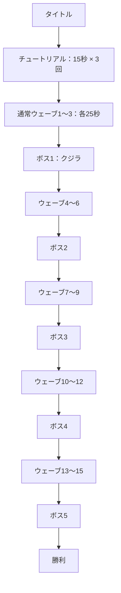

# 現在のゲーム進行

難易度選択のない、日本語専用の一本道の冒険です。

ボス2～5はサメ・イカ・カメ・カジキを毎回シャッフルした順番です。重複しません。各ボスの戦闘は時間制限を設けず、撃破するまで続きます。

## カードと回復

- 現在のカードの種類・効果・重ねがけを維持しています。
- チュートリアルのカードとレベルは通常ウェーブ1へ引き継ぎます。
- 各ウェーブ終了後に既存の選択方式でカードを選びます。
- ボス1～4の撃破後もカードを選び、その次の通常ウェーブへ進みます。
- ボス5の撃破後は勝利画面へ進みます。
- ウェーブ終了時の回復、ボス撃破時の最大体力50%回復も維持しています。
- カードが最大まで重なった場合の回復処理も既存のままです。

## 進行データ

`RunPhase` はプレイヤーが選ぶモードではなく、練習中か冒険中かを区別する内部状態です。`currentWave_` は冒険中の通常ウェーブ番号1～15、`bossesDefeated_` は撃破済みボス数0～5です。3の倍数のウェーブ終了後、必要なボスをまだ倒していなければボス戦へ進みます。ボス撃破後は撃破数を増やすため、同じボスへ戻らず次の通常ウェーブへ進みます。

`completedWaves_` は実際に終了したウェーブ数で、結果のスコア計算に使用します。最後の勝利はウェーブ15到達だけでは発生せず、ボス5体撃破で発生します。再挑戦とプレイ中の R は、順序・体力・所持カード・進行をリセットしてチュートリアルから開始します。

記録は `Data/highscore_campaign.dat` に保存し、旧ノーマル／ハードの記録は読み込みません。デバッグ操作を使ったプレイは記録しません。

## 表示と配布

ゲーム内の文字は日本語です。戦闘中は通常ウェーブ数・残り時間・ボス撃破数を表示し、結果画面にもボス撃破数を表示します。以前の難易度選択用画像は保管していますが、実行時には読み込まず、配布用 ZIP からも除外します。

今回の確認範囲は Debug/Release x64 のビルドと、タイトル・練習・通常ウェーブ・ボス・カード・勝敗画面の描画です。手動操作による最初から最後までの通しプレイは未実施です。
